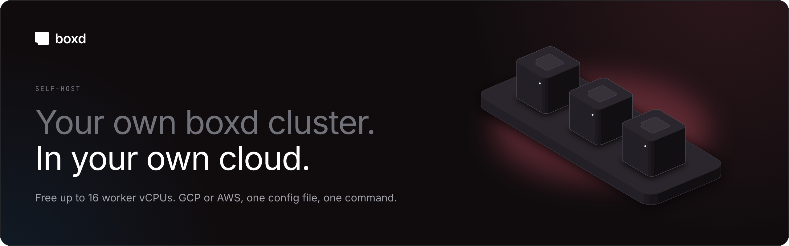
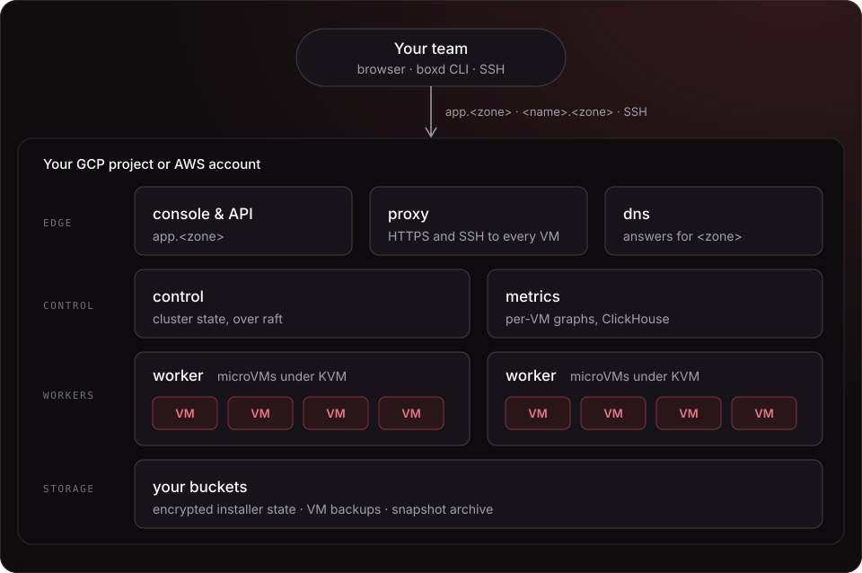

# boxd self-host

**Run a complete [boxd](https://boxd.sh) cluster in your own Google Cloud
project or AWS account, or on servers you already run.** You get microVMs
that boot in 4 ms and can be forked and snapshotted, each with its own SSH
and HTTPS, along with the console, DNS and automations. Everything is set by
one config file and installed by one command. The only thing to install on
your machine is Docker.

[Install on GCP](docs/INSTALL.md#install-on-gcp)
| [Install on AWS](docs/INSTALL.md#install-on-aws)
| [Install on bare metal](docs/INSTALL.md#install-on-bare-metal)
| [Reference](docs/REFERENCE.md)
| [Operations](OPERATIONS.md)
| [Releases](https://github.com/boxd-sh/self-host/releases)

## How to run

Choose the cloud you already use, or bring your own hosts.

| Run it on | You need | The command | Install |
|-----------|----------|-------------|---------|
| GCP | a Google Cloud project with billing | `./boxd-install apply` | [Install on GCP](docs/INSTALL.md#install-on-gcp) |
| AWS | an AWS account | `./boxd-install apply` | [Install on AWS](docs/INSTALL.md#install-on-aws) |
| Bare metal | Ubuntu 24.04 hosts you prepare: ssh, a private network, KVM on workers | `./boxd-install apply` | [Install on bare metal](docs/INSTALL.md#install-on-bare-metal) |

Wherever you run it, you also need a DNS zone whose parent zone you can add
records to, such as `boxd.example.com` under `example.com`. Set aside about
an hour: most of it is `apply`, which runs on its own for 20–40 minutes. Each
guide ends with you signed in to your cluster's console and starting your
first VM.
[INSTALL-PROMPT.md](INSTALL-PROMPT.md) has Claude Code take you through the
same install one step at a time.

## What runs in your cloud



A cluster is made of a few node roles. The **control** nodes run the
cluster's state over raft. The **workers** run the microVMs under KVM, on
boxd's own host kernel. The **proxy** connects every VM to the internet at
`https://<name>.<zone>` and over SSH. The **console** serves the web console,
the API and a CLI already set up for your cluster. A **dns** node answers for
your zone. A **metrics** node stores the graphs the console shows for each VM.
One node can have several roles. The examples put every role except the worker
on a single control node and add one worker.

Every install is driven by `cluster.toml`. Its state, including TLS keys, node
identities and provider secrets, is encrypted in a bucket you own (on bare
metal, a file next to `cluster.toml`), under a key that only you hold.
Binaries, the console, the CLI, the host kernel and the VM image come in a
release bundle that boxd signs. The installer checks that
signature against [`release-keys/`](release-keys) before it unpacks anything.

## What you get

- **Fast microVMs.** They boot in 4 ms, can be forked and snapshotted, and come
  in the [sizes you pick](docs/REFERENCE.md#machine-sizes-templates).
- **Every VM on the network.** Each one is reachable over HTTPS at
  `https://<name>.<zone>` and over SSH. You can also give it custom domains
  and raw TCP or UDP ports.
- **The console and the CLI.** `app.<zone>` serves the console and a
  [`boxd` CLI](docs/REFERENCE.md#the-cli-your-users-install) that already
  points at your cluster. It's the same CLI that `docs.boxd.sh` documents, and
  it comes with an agent skill for Claude Code, Codex and OpenCode.
- **Your own sign-in.** People sign in with Google or GitHub, or with
  [single sign-on](docs/REFERENCE.md#single-sign-on-oidc) through Entra ID,
  Okta, Google Workspace or Keycloak.
- **Certificates handled for you.** They come from Google Trust Services on
  GCP and ZeroSSL on AWS and bare metal. Inside a corporate network, they
  can come [from your own CA](docs/REFERENCE.md#tls-from-your-own-ca)
  instead.
- **Private if you need it.** With [private ingress](docs/INSTALL.md#private-ingress-on-aws)
  on AWS, no node has a public IP and people reach the cluster over your VPN.
- **Backups.** The installer creates a bucket for
  [VM disk backups](docs/REFERENCE.md#vm-backups) and can create one for a
  [snapshot archive](docs/REFERENCE.md#snapshot-archive).
- **Docker is the only requirement.** `./boxd-install` runs terraform,
  ansible, gcloud and the aws CLI inside a Docker image, at versions boxd has
  tested. You don't need the boxd source tree.

## Quick start

On GCP or AWS, below. On bare metal there is no cloud to sign in to and no
bucket: follow [Install on bare metal](docs/INSTALL.md#install-on-bare-metal).

1. **Sign in to your cloud.** Use `./boxd-install gcloud …` or
   `./boxd-install aws …`, which run the CLI in Docker. If you already have
   `gcloud` or `aws` installed, you can sign in with that instead. See
   [GCP](docs/INSTALL.md#1-sign-in) or [AWS](docs/INSTALL.md#1-sign-in-1).
2. **Make your state key**, once. It encrypts the cluster's state, and only
   you hold it. See [Your state key](docs/INSTALL.md#your-state-key).
3. **Create the state bucket.** See [GCP](docs/INSTALL.md#4-state-bucket) or
   [AWS](docs/INSTALL.md#4-state-bucket-1).
4. **Fill in `cluster.toml` and apply.** These commands are the same on
   either cloud:

```sh
cp cluster.example.toml cluster.toml      # change every value marked CHANGE
./boxd-install providers edit             # the console's sign-in (step 6)
./boxd-install apply 2>&1 | tee apply.log
```

`cluster.example.toml` is the GCP example. On AWS, copy
`examples/aws/cluster.toml` instead. Each step is explained in full in
[docs/INSTALL.md](docs/INSTALL.md).

### Once `apply` is done

At the end, `apply` prints the NS and glue records for your zone. Add them to
the parent zone at your DNS provider. The cluster requests its certificates
once the delegation resolves, which takes a few minutes. Then sign in at
`https://app.<zone>` before anyone else does: the first person to sign in owns
the cluster's org. The steps are in
[After apply](docs/INSTALL.md#after-apply-delegate-dns-and-check).

## When 16 vCPUs is not enough

Without a license key, a cluster runs on the **free tier**: its worker hosts
can have up to 16 vCPUs in all. That counts the logical CPUs of the worker
hosts, not the vCPUs the VMs get. A cluster over the limit keeps running and
keeps its machines, but refuses new ones. A [license key](docs/REFERENCE.md#license-key)
from [boxd](https://boxd.sh) lifts the limit. You can add a key at any time:
put it in a file next to `cluster.toml` and run `apply` again.

## Limitations

- **GCP, AWS or hosts you prepare.** On GCP and AWS a cluster runs in one
  zone of one region. On [bare metal](docs/INSTALL.md#install-on-bare-metal)
  the installer creates nothing: you provide Ubuntu 24.04 hosts with ssh, a
  private network inside `10.0.0.0/8`, public IPs for the proxy and dns
  nodes, and KVM and a data disk on workers.
- **Workers need hardware virtualization.** On GCP, use N2 (recommended) or
  N1; AMD, Arm and E2 machines can't run VMs. On AWS, use C7i/M7i/R7i or
  C8i/M8i/R8i with nested virtualization, or any `*.metal` type. The guides
  have the details.
- **The cluster runs DNS for its zone.** You need a zone you can delegate.
  With private ingress, you add a conditional forwarder on your internal DNS
  instead.
- **Telemetry.** Each cluster sends boxd one usage report an hour, with counts
  only and no personal data. Only a license key with telemetry opt-out lets
  you [turn it off](docs/REFERENCE.md#telemetry).

## Documentation

| File | What it's for |
|---|---|
| [`docs/INSTALL.md`](docs/INSTALL.md) | the install, step by step, on GCP, AWS or bare metal |
| [`docs/REFERENCE.md`](docs/REFERENCE.md) | configuration, upgrades, day-2 operations, troubleshooting |
| [`OPERATIONS.md`](OPERATIONS.md) | running the cluster day to day (`boxd-ctl`) |
| [`INSTALL-PROMPT.md`](INSTALL-PROMPT.md) | the same install, with Claude Code |
| `cluster.example.toml`, `examples/{gcp,aws,metal}/cluster.toml` | your starting config; copy it to `cluster.toml`, which git ignores |
| [`SECURITY.md`](SECURITY.md) | how to report a security problem |

## Contributing

Issues and pull requests are welcome. Pull requests go to `dev`; `main` holds
the latest release. [CONTRIBUTING.md](CONTRIBUTING.md) says how to run the
tests. Report security problems privately, as [SECURITY.md](SECURITY.md)
describes, not in a public issue.

## License

This repository is licensed under the [Apache License 2.0](LICENSE). See
[NOTICE](NOTICE). The license covers this repository only. The boxd software
the installer downloads and runs on your cluster (the binaries, console, CLI,
host kernel and VM images in the release bundle) is licensed separately under
the [Boxd Binary License](LICENSE-BINARIES.md) and isn't covered by it. You
may use it for personal use and your company's internal business operations.
You may not redistribute it, or decompile, disassemble or reverse engineer it,
except where the law allows it.
